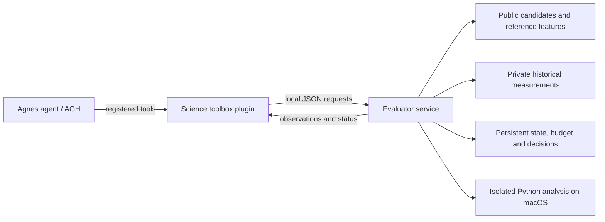

# Protein Rescue Lab

English | [简体中文](README.zh-CN.md)

Protein Rescue Lab is a research prototype for exploring **compensatory protein mutations**: given a damaging mutation, can another substitution restore a measured molecular property? It combines an agent-accessible scientific toolbox with a separate evaluator that reveals historical measurements under a fixed query budget. The project uses retrospective assay data; it does not run wet-lab experiments.

## Project overview

The toolbox lets an agent inspect candidate mutations, sequence features and reference structure, build simple predictions from already observed measurements, record hypotheses, request batches of historical measurements, and submit a conclusion with evidence. An evaluator enforces legal mutations, budgets, and persistent task state. Its main design feature is the separation of agent-visible information from evaluator-owned measurements, with predictions and rationales recorded before feedback.

This is an exploratory engineering and research system, not a validated protein-design service. Synthetic tasks demonstrate tool execution only. Structural proximity and non-additivity are not proof of a rescue mechanism. Historical GB1 and PDZ analyses have different protocols and limitations; this code release does not contain their full datasets or result archives, and it does not establish a general improvement in rescue discovery.

## Demo video

[Watch the project demonstration on Bilibili](https://www.bilibili.com/video/BV1iMpm6QEUz/). The video reflects the state at the time of recording; features and setup may differ from this release.

## Architecture



- `plugins/science-toolbox/`: AGH tool registration and session hooks.
- `scripts/science_toolbox.py` and `scripts/prepare_science_toolbox.py`: task state, synthetic task, local evaluator and science operations.
- `scripts/toolbox_python.py`: restricted analysis subprocess using macOS Seatbelt; execution is refused when the sandbox is unavailable.
- `scripts/`: GB1 and PDZ retrospective experiment, audit and reporting scripts; `plugins/` also contains earlier experiment integrations.
- `data/public_reference/residue_volumes.json`: AAindex-derived feature values used by the synthetic task; see [third-party sources](THIRD_PARTY.md).

The evaluator process can access its input labels; this separation is a design boundary and must not be mistaken for a complete OS-level isolation guarantee for every agent or experiment.

## Environment and local checks

The original environment used Python 3.13 and the pinned Python packages in `requirements.txt`. The Python sandbox checks require macOS and `/usr/bin/sandbox-exec`; Node.js is needed for AGH integration. To run the offline synthetic checks from the repository root:

```bash
python3 -m venv .venv
source .venv/bin/activate
python -m pip install -r requirements.txt
python scripts/test_science_toolbox.py
```

These checks use synthetic labels and do not call a model. They do not verify a full agent deployment. The original AGH integration was configured for a specific local daemon and SDK checkout; several scripts retain historical `/tmp` runtime paths and are not portable turnkey setup instructions. Full agent execution requires independently installing and configuring [Agnes Harness](https://github.com/AgnesAI-Labs/agnes-harness), a model provider, and adapting those local paths. Never commit credentials or local task state. The old datasets, run logs, generated reports, and bundled AGH checkout are not included in this release.

## Integration standards

The AGH plugin exposes typed tools including `science_state`, `science_candidates`, `science_sequence`, `science_structure`, `science_predict`, `science_python`, `science_record`, `science_query`, `science_controls`, and `science_finish`. Tool schemas are defined in [the plugin](plugins/science-toolbox/index.mjs). The plugin communicates with the local evaluator using HTTP POST and JSON; the evaluator validates a task token, session key, request identity, arguments and budget before returning JSON. See [the evaluator](scripts/science_toolbox.py) for the implemented contract and error handling. This is a project-specific interface, not a claim of MCP or another external protocol standard.

A query submits one to four unique legal candidates with predictions and a rationale before feedback; repeat handling and the current limits are implemented by the evaluator. These limits apply to the toolbox version in this repository and should not be assumed for earlier experiment plugins. Set `PROTEIN_RESCUE_ROOT` to the checkout root when launching AGH from another working directory. Model credentials and endpoints must be configured privately; no key is supplied.

## Sources and license

Original project code is released under the [MIT License](LICENSE). External software, datasets and reference materials remain under their own terms; sources and release limitations are listed in [THIRD_PARTY.md](THIRD_PARTY.md).
