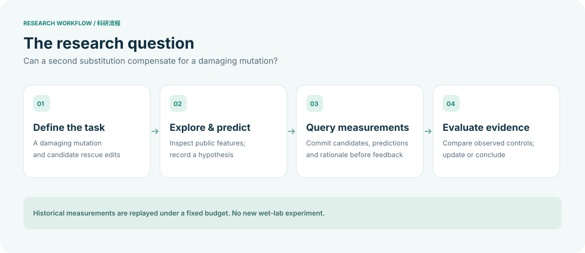

<div align="center">


**Can a second mutation help rescue a damaged protein?**<br>
An Agnes-powered scientific toolbox for exploring compensatory mutations with historical assay data.

[](LICENSE)


**English** · [简体中文](README.zh-CN.md)

[Watch the demo](https://www.bilibili.com/video/BV1iMpm6QEUz/) · [How it works](#architecture) · [Get started](#getting-started) · [Integration](#integration)

</div>

---

## Project overview

A damaging mutation can impair a protein’s function. A second substitution may compensate for that loss. **Protein Rescue Lab** investigates this possibility by pairing an Agnes agent with a scientific toolbox and an independent evaluator.

The agent examines candidate mutations, develops hypotheses and chooses what to query next. The evaluator reveals historical measurements within a fixed budget and keeps a record of each decision. Predictions remain distinct from measurements throughout the process.

| Explore the candidates | Test a hypothesis | Build a conclusion |
|:--|:--|:--|
| Inspect sequence features, reference structures and legal substitutions. | Submit candidates, predictions and a rationale before receiving feedback. | Compare observed controls, revise hypotheses and report what the evidence supports. |

Three design choices make the research process traceable:

- **Predict before feedback.** Candidate choices and their rationale are recorded before new measurements are revealed.
- **Control access to measurements.** The agent works with public features and observations already available to its task. The evaluator holds unqueried labels.
- **Preserve the research record.** Budgets, observations and decisions persist across requests, so recovery does not silently start a new trial.

> **Current scope** · This is a research prototype that replays historical assay data. It does not perform new wet-lab experiments. Synthetic tasks test tool execution, and the GB1 and PDZ analyses have separate protocols and limitations. The project does not establish a general gain in rescue discovery. Structural proximity and non-additivity alone do not demonstrate a rescue mechanism.

## Demo video

▶ **[Watch the project demonstration on Bilibili](https://www.bilibili.com/video/BV1iMpm6QEUz/)**

The recording shows the project at the time of the demo. Its features and setup may differ from this release.

## Architecture

### 1. Follow the research process

The workflow starts with a damaging mutation and ends with a conclusion supported by observed measurements, or an explicit statement that the evidence is insufficient.



### 2. See how the components work together

Agnes selects actions through registered scientific tools. The evaluator checks requests, manages the budget and returns permitted observations through the toolbox.


[View the bilingual HTML presentation](architecture.html). To display the page, download the repository and open `architecture.html` in a browser. GitHub’s file viewer displays its source code.

| Component | Role |
|:--|:--|
| [`plugins/science-toolbox/`](plugins/science-toolbox/) | Registers scientific tools and AGH session hooks. |
| [`scripts/science_toolbox.py`](scripts/science_toolbox.py) | Validates operations, maintains task state and serves the evaluator. |
| [`scripts/prepare_science_toolbox.py`](scripts/prepare_science_toolbox.py) | Prepares tasks and starts the local evaluator. |
| [`scripts/toolbox_python.py`](scripts/toolbox_python.py) | Runs restricted Python analysis with macOS Seatbelt. Execution is refused if the sandbox is unavailable. |
| [`scripts/`](scripts/) and [`plugins/`](plugins/) | Include retrospective GB1 and PDZ experiment code, audits, reports and earlier integrations. |

The evaluator can access its input labels. This separation of responsibilities does not guarantee complete OS-level isolation for every agent or experiment.

## Getting started

### Run the offline synthetic tests

Use **Python 3.13** and the versions pinned in `requirements.txt`. Sandbox tests require **macOS** with `/usr/bin/sandbox-exec`.

```bash
git clone https://github.com/Yongji0427/protein-rescue-lab.git
cd protein-rescue-lab
python3 -m venv .venv
source .venv/bin/activate
python -m pip install -r requirements.txt
python scripts/test_science_toolbox.py
```

The tests use synthetic labels and make no model calls. They verify toolbox behavior, not a complete agent deployment. The restricted analysis worker resolves the base Python executable, so it also depends on packages available in that base environment.

### Set up the full agent integration

Full execution requires Node.js, [Agnes Harness](https://github.com/AgnesAI-Labs/agnes-harness) and a privately configured model provider. The original integration used a specific local daemon and SDK checkout. Several scripts still contain historical `/tmp` paths that must be adapted to a new installation.

**A portable, fully verified setup procedure is not yet provided.** This release also excludes the original datasets, run logs, generated reports and bundled AGH checkout. Keep credentials and local task state out of version control.

## Integration standards

**Tool interface.** The AGH plugin provides typed tools for inspection, prediction, Python analysis, hypothesis recording, measurement queries, controls and conclusions. The [plugin source](plugins/science-toolbox/index.mjs) defines their schemas.

**Transport and validation.** The plugin communicates with the local evaluator through HTTP POST requests with JSON payloads. The evaluator validates task tokens, session keys, request identifiers, arguments and budgets before returning a response. See the [evaluator implementation](scripts/science_toolbox.py) for the request contract and error handling. This is a project-specific interface.

**Query rules.** Each query submits 1–4 unique legal candidates with predictions and a rationale before feedback. The evaluator handles repeated requests and enforces the current budget. These rules apply to this toolbox version and may differ from those of earlier plugins.

**Local configuration.** When starting AGH outside the repository, set `PROTEIN_RESCUE_ROOT` to the checkout root. Configure provider credentials and endpoints privately. No model key is included.

## Sources and license

Original project code is available under the [MIT License](LICENSE). Third-party software, datasets and reference materials retain their own terms. The [source acknowledgments](THIRD_PARTY.md) describe these dependencies and the AAindex-derived values used in the synthetic task.
