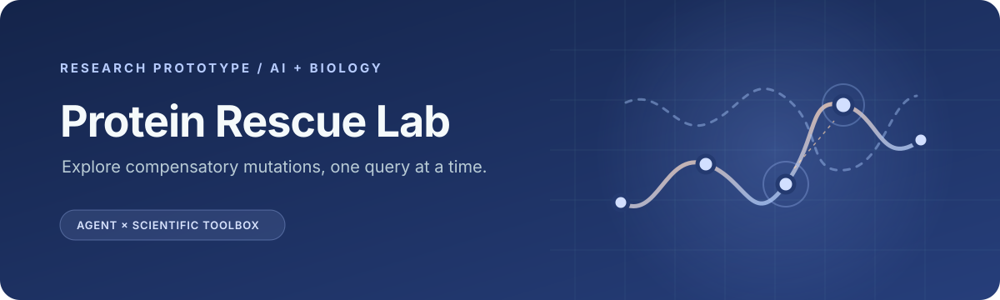
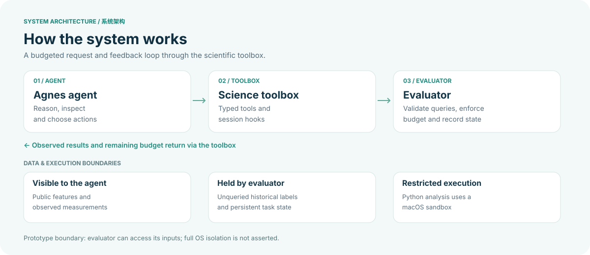

<div align="center">



**Can a second mutation help rescue a damaged protein?**<br>
An agent-accessible research toolbox for exploring that question with historical measurements.

[](LICENSE)


**English** · [简体中文](README.zh-CN.md)

[Watch the demo](https://www.bilibili.com/video/BV1iMpm6QEUz/) · [How it works](#architecture) · [Get started](#getting-started) · [Integration](#integration)

</div>

---

## The idea

Protein mutations can damage a measured property, but a second substitution may compensate for that damage. Protein Rescue Lab explores this problem by combining an Agnes agent with a scientific toolbox and a separate evaluator. The agent investigates candidate mutations; the evaluator reveals historical measurements under a fixed query budget.

| Explore | Reason | Evaluate |
|:--|:--|:--|
| Inspect candidate mutations, sequence features and reference structure. | Build simple predictions from observed measurements and record hypotheses. | Commit candidates before feedback, compare controls and submit an evidence-backed conclusion. |

**What makes the prototype distinctive:** agent-visible information is separated from evaluator-owned measurements; predictions and rationales are recorded before feedback; and task state and budgets persist across requests.

> **Research boundary** · This is an exploratory prototype, not a validated protein-design service. It replays historical assay data and does not conduct wet-lab experiments. Synthetic tasks demonstrate tool execution only. Structural proximity and non-additivity do not establish a rescue mechanism. GB1 and PDZ analyses have different protocols and limitations; no general improvement in rescue discovery is claimed.

## Demo video

▶ **[Watch the Protein Rescue Lab demonstration on Bilibili](https://www.bilibili.com/video/BV1iMpm6QEUz/)**

The video shows the project as recorded. Features and setup may differ from this release.

## Architecture



[Open the interactive HTML architecture page](architecture.html) (download the repository and open the file in a browser; GitHub displays HTML source).

| Component | Responsibility |
|:--|:--|
| [`plugins/science-toolbox/`](plugins/science-toolbox/) | Registers AGH tools and session hooks. |
| [`scripts/science_toolbox.py`](scripts/science_toolbox.py) | Maintains task state, validates operations and serves the evaluator. |
| [`scripts/prepare_science_toolbox.py`](scripts/prepare_science_toolbox.py) | Prepares the synthetic task and local evaluator. |
| [`scripts/toolbox_python.py`](scripts/toolbox_python.py) | Runs restricted analysis through macOS Seatbelt; refuses execution when the sandbox is unavailable. |
| [`scripts/`](scripts/) and [`plugins/`](plugins/) | Include GB1/PDZ retrospective experiment scripts and earlier integrations. |

The evaluator process can access its input labels. The design separation is not a guarantee of complete OS-level isolation for every agent or experiment.

## Getting started

### Run the offline synthetic checks

The original environment used **Python 3.13** and the pinned packages in `requirements.txt`. The sandbox checks require **macOS** and `/usr/bin/sandbox-exec`. From the repository root:

```bash
python3 -m venv .venv
source .venv/bin/activate
python -m pip install -r requirements.txt
python scripts/test_science_toolbox.py
```

These tests use synthetic labels and do not call a model. They check toolbox behavior; they do **not** verify a full agent deployment. The restricted analysis worker resolves the base Python executable, so its available packages also depend on that base environment.

### Full agent integration

The original AGH integration was configured for a specific local daemon and SDK checkout. Several scripts retain historical `/tmp` runtime paths and are **not portable turnkey setup instructions**. Full agent execution requires independently installing and configuring [Agnes Harness](https://github.com/AgnesAI-Labs/agnes-harness), a model provider, and adapting local paths. Node.js is required for the AGH integration. Never commit credentials or local task state.

This release does not include the old datasets, run logs, generated reports or bundled AGH checkout.

## Integration

The AGH plugin exposes typed tools for task state, candidate and structure inspection, prediction, Python analysis, hypothesis recording, measurement queries, controls and conclusions. Their schemas are defined in [the plugin](plugins/science-toolbox/index.mjs).

The plugin communicates with the local evaluator using **HTTP POST and JSON**. The evaluator validates the task token, session key, request identity, arguments and budget before returning JSON; see [the evaluator implementation](scripts/science_toolbox.py) for the contract and errors. This is a project-specific interface, not a claim of MCP or another external protocol standard.

A query submits **1–4 unique legal candidates**, predictions and a rationale before feedback. Repeated requests and current limits are handled by the evaluator; these limits apply to this toolbox version and should not be assumed for earlier experiment plugins. Set `PROTEIN_RESCUE_ROOT` to the checkout root when launching AGH from another working directory. Configure model credentials and endpoints privately; no key is supplied.

## Sources & license

Original project code is released under the [MIT License](LICENSE). External software, datasets and reference materials remain under their own terms. See [third-party sources and release limitations](THIRD_PARTY.md), including the AAindex-derived values used by the synthetic task.
