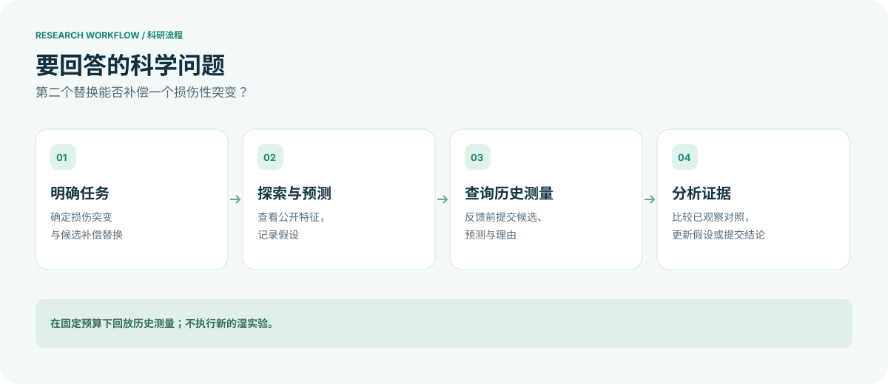

<div align="center">


**第二个突变，能否帮助受损的蛋白质恢复功能？**<br>
由 Agnes 驱动的科学工具箱，利用历史测定数据探索蛋白质补偿突变。

[](LICENSE)


[English](README.md) · **简体中文**

[观看演示](https://www.bilibili.com/video/BV1iMpm6QEUz/) · [技术架构](#技术架构) · [快速开始](#快速开始) · [集成标准](#集成标准)

</div>

---

## 项目介绍

一个损伤性突变可能削弱蛋白质的功能，而第二个替换有时能够补偿这种损失。**蛋白救援实验室**将 Agnes 智能体、科学工具箱和独立评测器结合起来，探索这种可能性。

智能体分析候选突变、提出假设，并决定下一步查询什么。评测器在固定预算内揭示历史测量，记录每一步决策。整个过程中，计算预测与实际测量始终明确区分。

| 探索候选 | 检验假设 | 形成结论 |
|:--|:--|:--|
| 查看序列特征、参考结构与合法替换。 | 在收到反馈前提交候选、预测和理由。 | 比较已观察对照，修正假设，并说明证据支持什么。 |

三个核心设计让研究过程可追溯：

- **先预测，再看反馈。** 在揭示新测量之前记录候选选择与推理依据。
- **控制测量访问范围。** 智能体使用公开特征和任务中已有的观察，未查询标签由评测器持有。
- **保留研究记录。** 预算、观察和决策跨请求保存，恢复任务不会悄然变成一次新试验。

> **当前范围** · 这是回放历史测定数据的研究原型，不执行新的湿实验。合成任务用于检查工具执行，GB1 与 PDZ 分析各有独立的方案和限制。项目尚未证明救援发现能力普遍提升，结构邻近和非加性本身也不能证明救援机制。

## 视频介绍

▶ **[在哔哩哔哩观看项目演示](https://www.bilibili.com/video/BV1iMpm6QEUz/)**

视频呈现录制时的项目状态，功能和配置可能与当前版本不同。

## 技术架构

### 1. 理解研究过程

流程从一个损伤性突变出发，最终形成由已观察测量支持的结论，或者明确说明证据仍然不足。



### 2. 查看系统如何协作

Agnes 通过注册的科学工具选择行动。评测器验证请求、管理预算，再经工具箱返回允许查看的观察结果。


[查看中英文 HTML 展示页](architecture.html#zh)。下载仓库后，用浏览器打开 `architecture.html` 即可查看页面。GitHub 文件浏览器显示的是源码。

| 组件 | 作用 |
|:--|:--|
| [`plugins/science-toolbox/`](plugins/science-toolbox/) | 注册科学工具与 AGH 会话钩子。 |
| [`scripts/science_toolbox.py`](scripts/science_toolbox.py) | 验证操作、维护任务状态并提供评测服务。 |
| [`scripts/prepare_science_toolbox.py`](scripts/prepare_science_toolbox.py) | 准备任务并启动本地评测器。 |
| [`scripts/toolbox_python.py`](scripts/toolbox_python.py) | 通过 macOS Seatbelt 执行受限 Python 分析。沙箱不可用时拒绝执行。 |
| [`scripts/`](scripts/) 与 [`plugins/`](plugins/) | 包含 GB1 和 PDZ 回顾性实验代码、审计、报告与早期集成。 |

评测器本身可以访问输入标签。这种职责分离并不保证所有智能体和实验都具备完整的操作系统级隔离。

## 快速开始

### 运行离线合成测试

使用 **Python 3.13** 和 `requirements.txt` 中固定的依赖版本。沙箱测试需要配备 `/usr/bin/sandbox-exec` 的 **macOS**。

```bash
git clone https://github.com/Yongji0427/protein-rescue-lab.git
cd protein-rescue-lab
python3 -m venv .venv
source .venv/bin/activate
python -m pip install -r requirements.txt
python scripts/test_science_toolbox.py
```

测试使用合成标签，不调用模型。它验证工具箱行为，不能证明完整智能体部署可运行。受限分析子进程会解析到基础 Python 可执行文件，因此也依赖基础环境中安装的包。

### 配置完整智能体集成

完整运行需要 Node.js、[Agnes Harness](https://github.com/AgnesAI-Labs/agnes-harness) 和私密配置的模型服务。原集成使用特定本地守护进程与 SDK 副本，部分脚本仍含有历史 `/tmp` 路径，需要根据新环境调整。

**当前尚未提供可移植且经过完整验证的安装流程。** 本版本也不包含原始数据集、运行日志、生成报告和 AGH 源码副本。请勿将凭据或本地任务状态提交到版本控制。

## 集成标准

**工具接口。** AGH 插件提供类型化工具，涵盖信息查看、预测、Python 分析、假设记录、测量查询、对照检查与结论提交。具体参数定义见[插件源码](plugins/science-toolbox/index.mjs)。

**通信与验证。** 插件使用 HTTP POST 和 JSON 与本地评测器通信。评测器检查任务令牌、会话键、请求标识、参数和预算后返回响应。请求契约与错误处理见[评测器实现](scripts/science_toolbox.py)。这是项目内部接口。

**查询规则。** 每次查询在反馈前提交 1 至 4 个不重复的合法候选、预测和理由。评测器处理重复请求并执行当前预算限制。这些规则适用于本版工具箱，可能与早期插件不同。

**本地配置。** 从仓库以外的目录启动 AGH 时，将 `PROTEIN_RESCUE_ROOT` 设为仓库根目录。模型凭据和端点须私密配置，本仓库不提供密钥。

## 来源与许可证

项目原创代码采用 [MIT 许可证](LICENSE)。第三方软件、数据集与参考资料保留各自的使用条款。[来源说明](THIRD_PARTY.md)列出了相关依赖，以及合成任务使用的 AAindex 衍生数值。
