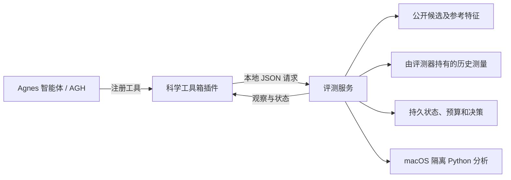

# 蛋白救援实验室（Protein Rescue Lab）

[English](README.md) | 简体中文

蛋白救援实验室是一个探索**蛋白质补偿突变**的研究原型：面对一个损伤性突变，另一个替换能否恢复某项已测量的分子性质？项目将智能体可调用的科学工具箱与独立评测服务结合，在固定查询预算下逐步揭示历史测量数据。项目使用回顾性测定数据，不执行新的湿实验。

## 项目介绍

工具箱允许智能体查看候选突变、序列特征和参考结构，基于已观察测量构建简单预测，记录假设，分批请求历史测量，并提交带证据的结论。评测器维护合法突变、预算和持久状态。其核心设计是将智能体可见信息与评测器持有的测量分开，并在反馈前记录预测和理由。

这是探索性的工程与研究系统，并非经过验证的蛋白质设计服务。合成任务只展示工具执行能力；结构邻近和非加性不能证明救援机制。历史 GB1 和 PDZ 分析采用不同方案且各有限制；本代码版本不包含完整数据集或结果档案，也不能据此宣称救援发现能力普遍提升。

## 视频介绍

[在哔哩哔哩观看项目演示](https://www.bilibili.com/video/BV1iMpm6QEUz/)。视频反映录制时的项目状态，功能和配置可能与本版本不同。

## 架构介绍



- `plugins/science-toolbox/`：AGH 工具注册和会话钩子。
- `scripts/science_toolbox.py`、`scripts/prepare_science_toolbox.py`：任务状态、合成任务、本地评测与科学操作。
- `scripts/toolbox_python.py`：使用 macOS Seatbelt 的受限分析子进程；沙箱不可用时拒绝执行。
- `scripts/`：GB1 与 PDZ 回顾性实验、审计和报告脚本；`plugins/` 还包含早期实验接口。
- `data/public_reference/residue_volumes.json`：合成任务使用的 AAindex 衍生特征值，来源见[第三方说明](THIRD_PARTY.md)。

评测进程本身可以访问输入标签；这种分离是设计边界，不能视为所有智能体和实验都已实现完整的操作系统级隔离。

## 环境配置与本地检查

原环境使用 Python 3.13 及 `requirements.txt` 中固定的依赖版本。Python 沙箱检查需要 macOS 和 `/usr/bin/sandbox-exec`；AGH 集成需要 Node.js。在仓库根目录运行离线合成测试：

```bash
python3 -m venv .venv
source .venv/bin/activate
python -m pip install -r requirements.txt
python scripts/test_science_toolbox.py
```

测试使用合成标签，不调用模型，也不能证明完整智能体部署可运行。原 AGH 集成针对特定本地守护进程和 SDK 配置；部分脚本仍保留历史 `/tmp` 运行路径，并非可直接移植的完整安装指南。完整智能体运行需要自行安装配置 [Agnes Harness](https://github.com/AgnesAI-Labs/agnes-harness) 和模型服务，并调整本地路径。请勿提交凭据或本地任务状态。本版本不包含旧数据集、运行日志、生成报告和 AGH 源码副本。

## 集成标准

AGH 插件提供 `science_state`、`science_candidates`、`science_sequence`、`science_structure`、`science_predict`、`science_python`、`science_record`、`science_query`、`science_controls` 和 `science_finish` 等类型化工具；参数定义见[插件代码](plugins/science-toolbox/index.mjs)。插件通过 HTTP POST 和 JSON 与本地评测器通信；评测器验证任务令牌、会话键、请求标识、参数和预算后返回 JSON。具体契约及错误处理见[评测器代码](scripts/science_toolbox.py)。这是项目内部接口，不宣称实现了 MCP 或其他外部协议标准。

每次查询在反馈前提交 1 至 4 个不重复的合法候选、预测和理由；重复请求处理及预算限制由评测器实现。上述约束适用于本仓库的工具箱版本，不能直接套用到早期实验插件。从其他工作目录启动 AGH 时，可将 `PROTEIN_RESCUE_ROOT` 设为仓库根目录。模型凭据和端点须自行私密配置，本仓库不提供密钥。

## 来源与许可证

项目原创代码采用 [MIT 许可证](LICENSE)。外部软件、数据集和参考资料仍遵守各自条款；来源和发布范围见[第三方说明](THIRD_PARTY.md)。
