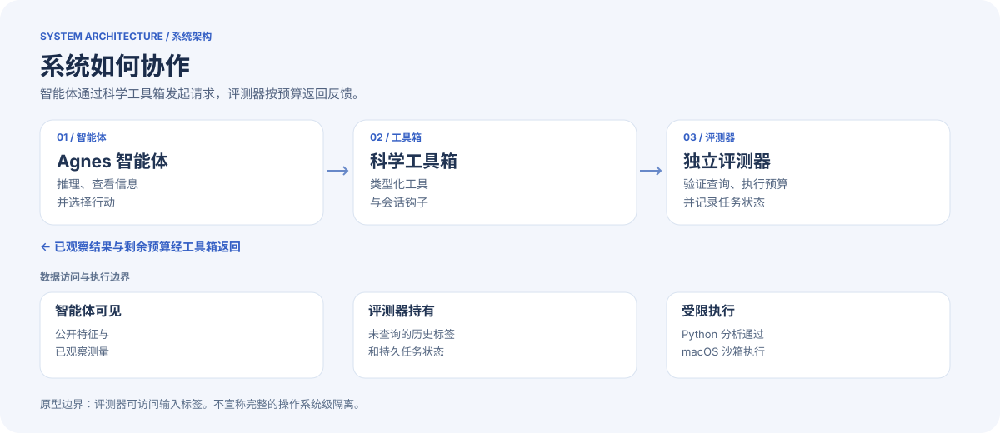

<div align="center">


**第二个突变，能否帮助受损的蛋白质恢复功能？**<br>
一个面向智能体的研究工具箱，利用历史测量数据探索蛋白质补偿突变。

[](LICENSE)


[English](README.md) · **简体中文**

[观看演示](https://www.bilibili.com/video/BV1iMpm6QEUz/) · [技术架构](#技术架构) · [快速开始](#快速开始) · [集成方式](#集成方式)

</div>

---

## 项目介绍

蛋白质突变可能损害某项可测量的性质，而第二个替换有时可能产生补偿。蛋白救援实验室将 Agnes 智能体、科学工具箱和独立评测器结合起来探索这一问题：智能体分析候选突变，评测器在固定查询预算下逐步揭示历史测量。

| 探索 | 推理 | 验证 |
|:--|:--|:--|
| 查看候选突变、序列特征和参考结构。 | 根据已观察的测量构建简单预测并记录假设。 | 在反馈前提交候选，比较对照并给出有证据支持的结论。 |

**项目的核心设计：**将智能体可见的信息与评测器持有的测量分开；在反馈前记录预测和理由；跨请求保留任务状态与预算。

> **研究边界** · 这是探索性原型，并非经过验证的蛋白质设计服务。项目回顾历史测定数据，不执行新的湿实验；合成任务仅展示工具执行能力。结构邻近和非加性不能证明救援机制。GB1 和 PDZ 分析的方案与限制不同，项目不宣称救援发现能力普遍提升。

## 视频介绍

▶ **[在哔哩哔哩观看蛋白救援实验室演示](https://www.bilibili.com/video/BV1iMpm6QEUz/)**

视频反映录制时的项目状态，功能和配置可能与本版本不同。

## 技术架构



[查看可切换语言的 HTML 架构展示](architecture.html)（下载仓库后用浏览器打开；GitHub 页面显示 HTML 源码）。

| 组件 | 职责 |
|:--|:--|
| [`plugins/science-toolbox/`](plugins/science-toolbox/) | 注册 AGH 工具和会话钩子。 |
| [`scripts/science_toolbox.py`](scripts/science_toolbox.py) | 维护任务状态、验证操作并提供评测服务。 |
| [`scripts/prepare_science_toolbox.py`](scripts/prepare_science_toolbox.py) | 准备合成任务和本地评测器。 |
| [`scripts/toolbox_python.py`](scripts/toolbox_python.py) | 使用 macOS Seatbelt 执行受限分析；沙箱不可用时拒绝执行。 |
| [`scripts/`](scripts/) 与 [`plugins/`](plugins/) | 包含 GB1/PDZ 回顾性实验脚本和早期集成。 |

评测进程本身可以访问输入标签；这种设计分离不能视为所有智能体和实验都已实现完整的操作系统级隔离。

## 快速开始

### 运行离线合成测试

原环境使用 **Python 3.13** 及 `requirements.txt` 中固定的依赖版本。沙箱检查需要 **macOS** 和 `/usr/bin/sandbox-exec`。在仓库根目录运行：

```bash
python3 -m venv .venv
source .venv/bin/activate
python -m pip install -r requirements.txt
python scripts/test_science_toolbox.py
```

测试使用合成标签，不调用模型；它检查工具箱行为，**不能证明完整智能体部署可运行**。受限分析子进程会解析到基础 Python 可执行文件，因此其可用依赖也取决于基础环境。

### 完整智能体集成

原 AGH 集成针对特定本地守护进程和 SDK 配置；部分脚本仍保留历史 `/tmp` 运行路径，**并非可直接移植的完整安装指南**。完整智能体运行需要自行安装配置 [Agnes Harness](https://github.com/AgnesAI-Labs/agnes-harness) 和模型服务，并调整本地路径。AGH 集成需要 Node.js。请勿提交凭据或本地任务状态。

本版本不包含旧数据集、运行日志、生成报告和 AGH 源码副本。

## 集成方式

AGH 插件提供类型化工具，支持查看任务状态、候选与结构、预测、Python 分析、记录假设、查询测量、检查对照和提交结论。参数定义见[插件代码](plugins/science-toolbox/index.mjs)。

插件通过 **HTTP POST 和 JSON** 与本地评测器通信。评测器验证任务令牌、会话键、请求标识、参数和预算后返回 JSON；具体契约与错误处理见[评测器代码](scripts/science_toolbox.py)。这是项目内部接口，不宣称实现了 MCP 或其他外部协议标准。

每次查询在反馈前提交 **1 至 4 个不重复的合法候选**、预测和理由；重复请求处理及当前限制由评测器实现。这些约束适用于本仓库的工具箱版本，不能直接套用到早期实验插件。从其他工作目录启动 AGH 时，可将 `PROTEIN_RESCUE_ROOT` 设为仓库根目录。模型凭据和端点须自行私密配置，本仓库不提供密钥。

## 来源与许可证

项目原创代码采用 [MIT 许可证](LICENSE)。外部软件、数据集和参考资料仍遵守各自条款。详见[第三方来源与发布范围](THIRD_PARTY.md)，其中包括合成任务使用的 AAindex 衍生数值。
